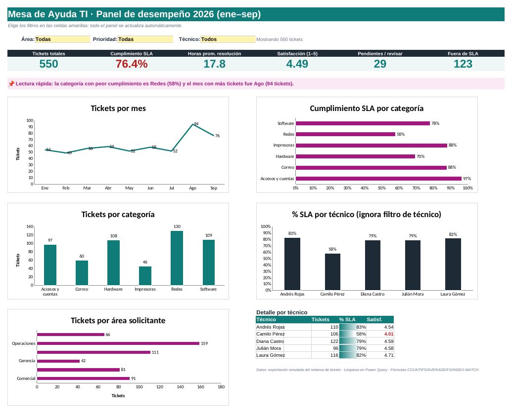

# 📊 Análisis de la Mesa de Ayuda TI con Excel + IA

Proyecto final de la **Prueba de Certificación – Módulo 3: Visualización inteligente y proyecto aplicado** (Universidad EAN).
Autor: **Nicolás Felipe Becerra Jiménez** · Ingeniería de Sistemas.



## 🧩 El problema
Una empresa mediana (caso simulado: *Distribuidora Andina S.A.S.*) recibe ~60 tickets de soporte al mes y no sabe:
1. Si cumple el acuerdo de nivel de servicio (SLA).
2. Qué categorías y técnicos concentran los retrasos.
3. Por qué en agosto el soporte “colapsó”.

## 🗂️ Estructura del repositorio
```
├── Analisis_Mesa_Ayuda_Excel_IA.xlsx    # Archivo funcional: datos, fórmulas y dashboard
├── docs/
│   ├── Informe_Proyecto_Final_Excel_IA.docx   # Bitácora / informe
│   └── img/                               # Gráficos y capturas
├── powerquery/
│   └── limpieza_tickets.pq                # Código M de la limpieza
├── data/
│   └── tickets_crudos.csv                 # Exportación original (simulada, con errores)
└── README.md
```

## 🧹 Limpieza (Power Query)
| Paso | Resultado |
|---|---|
| Filas vacías eliminadas | 5 |
| Duplicados eliminados | 14 |
| Variantes de texto unificadas | Área 11→6, Categoría 12→6, Prioridad 5→4 |
| Fechas en texto convertidas | 132 |
| Fechas imposibles marcadas “Revisar” | 6 |
| Calificaciones fuera de rango anuladas | 4 |
| **Registros finales** | **550 de 569** |

## 🧮 Fórmulas clave
- `Horas_Resolucion` → `=SI(C2="";"";REDONDEAR((C2-B2)*24;2))`
- `SLA_Horas` → `=INDICE(Parametros!$B$5:$B$8;COINCIDIR(F2;Parametros!$A$5:$A$8;0))`
- `Cumple_SLA` → `=SI(L2="";"Pendiente";SI(L2<=M2;"Sí";"No"))`
- KPIs del dashboard con `CONTAR.SI.CONJUNTO` y `PROMEDIO.SI.CONJUNTO` + comodín `*` para el filtro “Todas”.

## 📈 Dashboard
- 6 KPIs: tickets, % SLA, horas promedio, satisfacción, pendientes y fuera de SLA.
- Filtros desplegables por **Área, Prioridad y Técnico** (todo se recalcula).
- Frase de “lectura rápida” dinámica (data storytelling).
- Tabla dinámica con **segmentadores** para exploración libre.

## 💡 Hallazgos principales
- Cumplimiento del SLA: **76,4 %** (meta sugerida 85 %).
- **Redes** es el cuello de botella: 58 % de cumplimiento y 27,7 h promedio.
- **Agosto**: 94 tickets (+70 %), 49 % de ellos de Redes → posible incidente de infraestructura.
- Diferencias de cumplimiento entre técnicos que conviene revisar con contexto (carga y tipo de ticket).

## 🤖 IA utilizada
- **Analizar datos (Ideas):** diagnóstico inicial y detección de patrones.
- **Copilot en Excel:** fórmulas en lenguaje natural, sugerencias de gráficos e insights.
- Todo resultado de IA se verificó contra las fórmulas del libro. Ver la reflexión ética en el informe.

## ▶️ Cómo usarlo
1. Descarga `Analisis_Mesa_Ayuda_Excel_IA.xlsx` y ábrelo en Excel (Microsoft 365 recomendado).
2. Ve a la hoja **Dashboard** y cambia los filtros de las celdas amarillas.
3. Para repetir la limpieza: sobre `tblCrudos` → *Datos > Desde tabla/rango* → *Editor avanzado* → pega `powerquery/limpieza_tickets.pq`.

## 🎥 Video
[Ver presentación](PEGA_AQUI_EL_ENLACE_DE_YOUTUBE_O_DRIVE)

> ⚠️ Los datos son **simulados** con fines académicos; no corresponden a ninguna empresa ni persona real.
